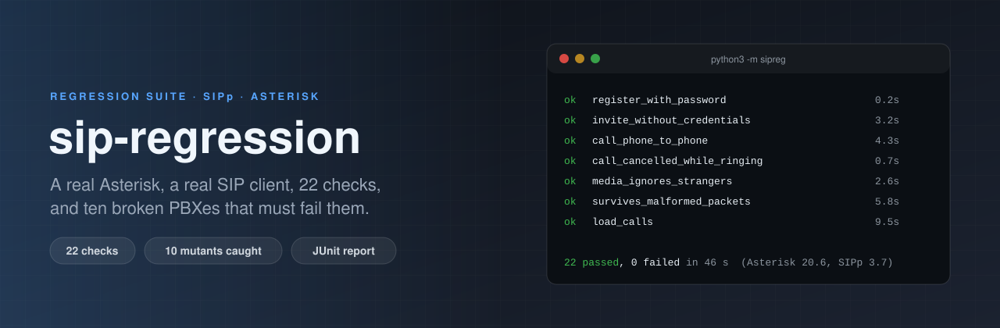

<p align="center">
  
</p>

<p align="center">
  <a href="https://github.com/ErenOzgu/sip-regression/actions/workflows/ci.yml"></a>
  
  
  
  <a href="LICENSE"></a>
</p>

A regression suite for an [Asterisk](https://www.asterisk.org/) PBX. It starts a throw-away Asterisk on loopback, drives it with [SIPp](https://sipp.sourceforge.net/) scenarios and a small Python phone, and checks what the PBX does: who may register, who may call, whether audio comes back, what happens when a call is cancelled, hung up from the PBX side, put on hold, or when someone sends garbage. It writes a JUnit report and a Markdown summary, so it drops into any CI.

The test PBX configuration is in [`pbx/`](pbx/) and is deliberately small. Point the suite at your own with `SIPREG_PBX_DIR=/path/to/your/templates` (see [Use it on your own PBX](#use-it-on-your-own-pbx)).

## What it checks

22 checks, about 45 seconds. `python3 -m sipreg --list` prints them; add `--json` for a JSON array of `name`, `group`, `title` and `needs_raw`.

| Group | Check | What it proves |
|---|---|---|
| **signalling** | `register_with_password` | A phone with the right password registers, and `Expires: 0` removes it again |
| | `register_wrong_password` | A wrong password is refused with 401 and shows up in the security log as `ChallengeResponseFailed`, the line fail2ban reads |
| | `register_unknown_user` | An unknown user gets *exactly* the answers a wrong password gets, so accounts cannot be guessed. The security log still tells the two apart (`InvalidAccountID`) |
| | `options_needs_credentials` | OPTIONS from a stranger is challenged; from a user with a password it gets 200 |
| | `invite_without_credentials` | An INVITE with no password gets 401 and never reaches the dialplan |
| | `invite_unknown_extension` · `invite_busy` · `invite_congestion` | 404, 486 and 503 reach the caller |
| | `bye_for_unknown_call` | A stray BYE is answered (481), not ignored |
| **calls** | `call_echo_test` | The call is answered, carries three seconds of RTP and ends cleanly |
| | `call_ended_by_pbx` | When the PBX hangs up, the phone receives a BYE it can answer |
| | `call_hold_and_resume` | Two re-INVITEs (`sendonly`, `sendrecv`) are accepted and the call survives |
| | `call_phone_to_phone` | 101 calls 102: the PBX rings the registered phone, bridges the call and relays the hang-up |
| | `call_cancelled_while_ringing` | The caller gets 487, the ringing phone sees the CANCEL and refuses with 487, no channel stays up |
| **media** | `media_is_echoed` | 100 RTP packets into the echo test come back intact and in order |
| | `media_ignores_strangers` | With strict RTP, 110 packets injected from an address that is not in the call are dropped and never answered, and the real call is not disturbed |
| | `media_control_loose_rtp_is_detected` | The control for the check above: with strict RTP switched off the same injection *is* answered |
| **posture** | `listens_only_where_expected` | The only open port is SIP on the loopback address: no AMI, no HTTP, no IAX, no second SIP stack |
| **robustness** | `survives_malformed_packets` | 35 broken datagrams (truncated, no Via, 300 Via headers, NUL bytes, a 64 KB datagram, ...) then a flood of 1000 INVITEs: same process, still answering |
| | `load_registrations` | 300 registrations at 100 per second, none fail |
| | `load_calls` | 200 short calls at 25 per second, none fail, no channel is left behind, memory grows by less than 100 MB |
| **health** | `health_after_everything` | Same process as at the start, no calls left, and no warning or error in Asterisk's log that the tests did not cause |

## Quick start

```bash
sudo apt install asterisk sip-tester python3       # Ubuntu 22.04 or 24.04
sudo systemctl stop asterisk                       # the suite runs its own instance, on port 5160
sudo setcap cap_net_raw+ep "$(readlink -f "$(which sipp)")"   # SIPp plays audio through a raw socket

python3 -m sipreg                                  # everything
python3 -m sipreg --only call_phone_to_phone media_ignores_strangers
python3 -m sipreg --junit junit.xml --artifacts traces/   # reports, SIPp traces, Asterisk logs
```

The suite needs Linux (it reads `/proc`), Python 3.10+, `asterisk` and `sipp` on the `PATH`, and nothing else: there is no `pip install`. It does not touch `/etc/asterisk` or the packaged service; everything lives in a temporary directory that is deleted afterwards (`--keep` keeps it).

The `setcap` line (or running as root) is only for the two checks that play audio through SIPp. Without it they are reported as skipped, with the command to fix it, and `--require-all` turns a skip into a failure, which is what CI uses.

A failing check prints what it expected, what happened, the SIPp transcript and the Asterisk log from that moment:

```text
FAIL  invite_without_credentials      3.2s  an INVITE with no password is answered 401 and never reaches the dialplan
      expected: answers to an unauthenticated INVITE from 101
        wanted: ['401 Unauthorized']
        got:    ['200 OK']
```

Exit status is 0 when everything passed, 1 when a check failed, 2 when Asterisk could not be started. In GitHub Actions the Markdown summary goes to the run page by itself (`$GITHUB_STEP_SUMMARY`).

## How a check is written

A scenario is plain SIPp XML. This is the whole of "somebody who forgot the password must be turned away":

```xml
<send retrans="500">
  REGISTER sip:[remote_ip]:[remote_port] SIP/2.0
  ...
</send>
<recv response="401" auth="true"/>
<send retrans="500">
  REGISTER ... CSeq: 2 REGISTER ... [authentication]
</send>
<recv response="401"/>        <!-- a 200 here is an unexpected message and fails the call -->
```

and the check around it in [`sipreg/suite.py`](sipreg/suite.py):

```python
@case("register_wrong_password", "a wrong password is refused and shows up as a security event")
def _(ctx):
    mark = len(ctx.pbx.security_log())
    r = ctx.sipp("register_bad_password", password="definitely-wrong")
    expect_equal(finals(r), ["401 Unauthorized", "401 Unauthorized"], "answers to a wrong password")
    expect("101" not in ctx.pbx.contacts(), "no contact is stored for a refused REGISTER")
    expect(ctx.security_events(mark, "ChallengeResponseFailed", "101") >= 1, "a security event for account 101")
```

SIPp is good at signalling and poor at looking inside the PBX, so the Python side asks Asterisk (`pjsip show contacts`, `core show channels`, `/proc`) and reads its logs. Audio is checked by a [tiny SIP phone in Python](sipreg/ua.py) instead of SIPp, because "the RTP came back intact" is easier to say in code than in XML.

## The checks can fail

A suite that has never failed proves little. [`hack/mutants.py`](hack/mutants.py) breaks the test PBX on purpose, one way at a time, and runs the check that should notice. CI runs it, and every mutant has to be caught:

| Mutant | Caught by |
|---|---|
| An `[anonymous]` endpoint lets unknown callers into the dialplan | `invite_without_credentials` |
| Endpoint 101 loses its `auth` line | `invite_without_credentials`, `options_needs_credentials`, `register_wrong_password` |
| `strictrtp = no` | `media_ignores_strangers` |
| Extension 602 answers instead of reporting busy | `invite_busy` |
| A catch-all `_X.` pattern answers every number | `invite_unknown_extension` |
| AMI listens on `0.0.0.0` | `listens_only_where_expected` |
| The HTTP server listens on `0.0.0.0` | `listens_only_where_expected` |
| SIP listens on `0.0.0.0` instead of loopback | `listens_only_where_expected` |
| An extension calls an application that does not exist | `health_after_everything` |
| Extension 601 never hangs up | `call_ended_by_pbx` |

The same idea applies inside the harness: `media_control_loose_rtp_is_detected` boots a second PBX with strict RTP off and requires the injection to be answered. Without that control, "nothing came back" could just mean the test never injected anything.

## Use it on your own PBX

The templates in [`pbx/`](pbx/) are copied into a temporary directory and the placeholders in `pjsip.conf` and `rtp.conf` are filled in (SIP port, RTP range, the two passwords, `strictrtp`). `SIPREG_PBX_DIR` replaces that directory:

```bash
cp -r pbx my-pbx && $EDITOR my-pbx/pjsip.conf my-pbx/extensions.conf
SIPREG_PBX_DIR=$PWD/my-pbx python3 -m sipreg
```

The checks assume what the test PBX offers: endpoints `101` and `102` with passwords from `sipreg/pbx.py`, and extensions 600 (echo), 601 (answers, waits a second, hangs up), 602 (busy), 603 (congestion) and 101/102 (ring the phone). Keep those and change everything else, and the suite tells you whether your hardening, codecs or transport settings broke a basic call.

## Things worth knowing

These came from running against real Asterisk 18 and 20, not from the documentation:

- **A wrong password and an unknown user look the same on the wire, and different in the log.** Both get 401 twice. Asterisk records `ChallengeResponseFailed` for one and `InvalidAccountID` for the other, which is what lets fail2ban act without helping an attacker enumerate extensions.
- **OPTIONS from a stranger is challenged, not answered.** There is no unauthenticated 200 to fingerprint.
- **Re-INVITEs inside an established call are not challenged again.** Hold and resume work without a second digest round.
- **Strict RTP is what keeps outsiders out of a call.** With it off, Asterisk answered every one of 110 injected packets, to the outsider's own address. With it on, none.
- **A cancelled call needs the INVITE's branch.** SIPp's `[branch]` is a per-message counter, so a CANCEL built the obvious way gets `481 Call/Transaction Does Not Exist`. An ACK for an error answer with the wrong branch is quietly tolerated, which is worse: the test passes while the scenario is wrong. [`sipreg/trace.py`](sipreg/trace.py) reads SIPp's message trace after every run and fails on that, and a unit test recomputes every `[branch-N]` offset from the XML.
- **A SIPp phone cannot both register and receive the call.** An INVITE has a new Call-ID, so SIPp treats it as an unknown call and answers 603. The phone is two processes: one registers, one waits at the registered port.
- **A stock Asterisk logs over a hundred warnings and errors while booting** (126 on Asterisk 20.6: missing optional `.conf` files). The log check starts when Asterisk says it is ready.
- **Hostile input makes the SIP stack write WARNING and ERROR lines.** Those are tolerated after `survives_malformed_packets` and only from `pjproject`; from anywhere else, or before that check, they fail `health_after_everything`.

## Layout

```text
pbx/             test PBX configuration (templates)
scenarios/       SIPp scenarios: registration, calls, phones (XML)
sipreg/
  suite.py       the 22 checks
  pbx.py         starts Asterisk, asks it questions (contacts, channels, listeners, logs)
  sipp.py        runs a scenario, reads its statistics and trace
  trace.py       checks that the scenarios themselves spoke correct SIP
  ua.py          small SIP phone: digest login, RTP, strict-RTP injection test
  malformed.py   35 hostile datagrams and the INVITE flood
  pcap.py        writes the RTP audio SIPp plays (no binary files in the repository)
  report.py      JUnit XML and Markdown
hack/mutants.py  breaks the PBX ten ways and checks the suite notices
tests/           unit tests that need neither Asterisk nor SIPp
```

## Limits

- **UDP only.** No TCP, TLS or WebSocket transports, no SRTP.
- **One PBX, one codec family.** G.711 on loopback; no transcoding, no video, no T.38, no NAT.
- **Not a benchmark.** The load checks prove that nothing breaks under a burst on one machine, not how many calls a server can carry.
- **Linux with `/proc`.** The listener and memory checks read it.
- **Asterisk 18 and 20, PJSIP.** `chan_sip` is switched off in the test PBX.
- **It tests behaviour, not configuration.** For the configuration itself, see [asterisk-conf-lint](https://github.com/ErenOzgu/asterisk-conf-lint).

## Related

- [asterisk-conf-lint](https://github.com/ErenOzgu/asterisk-conf-lint): a security linter for the configuration files this suite exercises
- [asterisk-gcp-iac](https://github.com/ErenOzgu/asterisk-gcp-iac): a hardened Asterisk on Google Cloud, built from code
- [asterisk-exporter](https://github.com/ErenOzgu/asterisk-exporter): Prometheus metrics from the Asterisk Manager Interface

## More

[Design notes](docs/design-notes.md) (why it is built this way, how it was checked),
[CHANGELOG](CHANGELOG.md) and [ROADMAP](ROADMAP.md).

## License

MIT, see [LICENSE](LICENSE).
